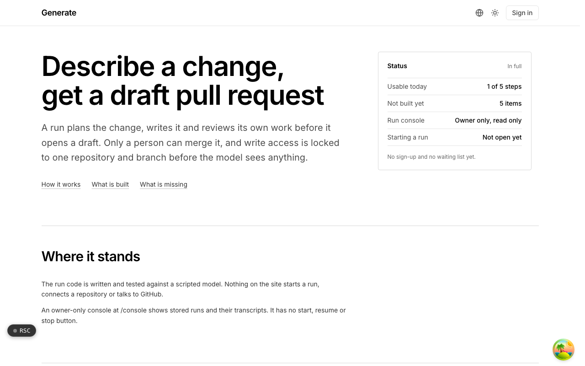
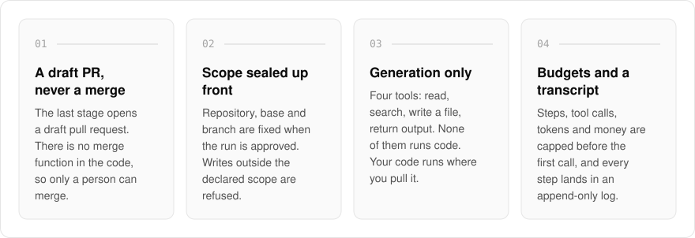
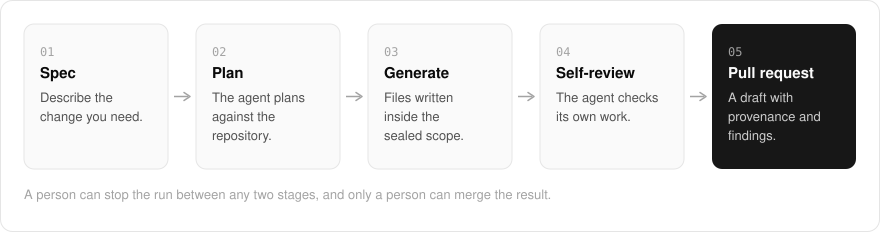

  <picture>
    <source media="(prefers-color-scheme: dark)" srcset=".github/assets/hero-dark.png">
    
  </picture>

<h1 align="center">generate.me.at</h1>

<strong>Describe a change, get a draft pull request.</strong>

  
  
  

  <a href="#features">Features</a> ·
  <a href="#how-it-works">How it works</a> ·
  <a href="#built-with">Built with</a>

AI coding agents are quick to write code and just as quick to push it somewhere you did not mean. I built generate.me.at as agentic development with a human review gate: you describe what you need, connect a repository, and a run plans the change, writes it and reviews its own work before it opens a **draft** pull request. Write access is locked to one repository and branch before the model sees anything, and only a person can merge.

> **Status:** in development. The run engine is written and tested against a scripted model. Today the only reachable surface is an owner-only, read-only run console, and nothing on the site starts a run yet.

  <picture>
    <source media="(prefers-color-scheme: dark)" srcset=".github/assets/overview-dark.svg">
    
  </picture>

## Why generate.me.at

| The usual AI coding agent | generate.me.at |
| --- | --- |
| Write access as wide as its token | Write access sealed to one repository and branch |
| Can push or merge on its own | Opens a draft pull request, with no merge function in the code |
| Runs the code it writes | Generation only: none of its four tools runs code |
| Trusts what the repository says | Treats every file as attacker-controlled |
| Spend you find out about later | Steps, tool calls, tokens and money capped before the first call |

## Features

- **Five stages, each one a stopping point**: a run moves through spec, plan, generation, self-review and pull request, and a person can stop it between any two.
- **A draft pull request, never a merge**: the last stage opens a draft against the locked target. There is no merge function in the code at all.
- **Write access fixed up front**: the repository, base and branch are sealed when the run is approved. The model cannot pass them as arguments, and writes outside the declared scope are refused.
- **Generation only**: the model has four tools (read, search, write a file, return structured output) and none of them runs code. Generated code runs in your environment when you pull the branch.
- **Built for hostile repositories**: every file in a connected repository is treated as attacker-controlled, with prompt-injection containment and an acceptable-use check before every model call.
- **A budget on every run**: limits on steps, tool calls, tokens and money are set before the first model call and checked before every call after it.
- **An append-only, audited transcript**: every step is recorded and never edited, and the pull request body carries a provenance block and the self-review findings.
- **Self-hostable with your own models**: a single-tenant run engine with bring-your-own keys, including local endpoints such as Ollama, vLLM, llama.cpp or LM Studio, so your code and prompts stay on your infrastructure. Run recipes are plain Markdown and YAML.

## How it works

  <picture>
    <source media="(prefers-color-scheme: dark)" srcset=".github/assets/flow-dark.svg">
    
  </picture>

A run starts from a written spec, and the agent plans against the repository before it writes anything. Every file it writes stays inside the scope sealed at approval, and the agent then reviews its own output. The last stage opens a draft pull request whose body carries a provenance block and the review findings, and the full transcript is kept append-only.

## Built with

  
  
  
  
  
  

- Next.js 16 (App Router), React 19, TypeScript
- Tailwind CSS 4
- A generation-only agent loop with a closed tool set and hard budgets
- Anthropic or any OpenAI-compatible model endpoint
- GitHub REST API with short-lived, repository-scoped tokens
- Drizzle ORM with Postgres
- Better Auth

## Part of the me.at family

generate.me.at is one of my [`*.me.at`](https://me.at) apps. They share one design system, one account, and one app shell. Development happens in a private monorepo; this repository is the project's public-facing home.

## License

Source-available. See [LICENSE](LICENSE).
